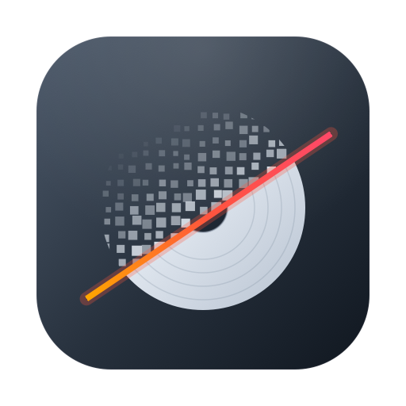

<div align="center">



# WipeDisk

macOS için ham disk silme aracı — SwiftUI arayüz, ayrıcalıklı yardımcı işlem, canlı ilerleme.

</div>

---

> [!WARNING]
> **Bu araç verileri kalıcı olarak yok eder.** Üzerine yazılan bir disk kurtarılamaz.
> Diski silmeden önce mutlaka **Deneme modu** ile çalıştırın ve aygıt tanımlayıcısını
> (`diskN`) iki kez kontrol edin.
>
> Yazılım **"OLDUĞU GİBİ"**, hiçbir garanti olmadan sunulur. Kullanımından doğan
> **her türlü veri kaybı ve zarardan kullanıcı sorumludur** — bkz.
> [Sorumluluk reddi](#sorumluluk-reddi).

## Ne yapar

Seçilen tam diskin üzerine, seçilen desende baştan sona yazar. Dosyaları silmez —
bölüm tablosu dahil bütün ham blok aygıtının üzerine yazar.

- **Silme yöntemleri:** tek geçiş sıfır, tek geçiş rastgele, DoD 5220.22-M (7 geçiş), Gutmann (35 geçiş)
- **Doğrulama:** son geçişten sonra disk geri okunup yazılanla karşılaştırılır
- **Deneme modu:** bütün akış çalışır, diske tek bayt gitmez
- **Silme sonrası biçimlendirme:** ExFAT, APFS, HFS+, FAT32, NTFS
- **Canlı ilerleme:** geçiş bazında yüzde, hız, geçen ve kalan süre
- **Durdurulabilir:** işlem sırasında durdurma isteği gönderilebilir

## Biçimlendirme

**Biçimlendir** sekmesi diskin tamamını tek adımda tek birim yapar: dosya sistemi,
şema ve birim adı seçilir, gerisini `diskutil eraseDisk` halleder. Günlük kullanımda
istenen şey genelde budur.

Biçimlendirme verinin **üzerine yazmaz** — yalnızca bölüm tablosunu ve dosya sistemini
yeniler. Veriyi kurtarılamaz kılmak için **Sil** sekmesi gerekir. Onay penceresi
bunu açıkça söyler.

## Bölümleme

**Bölümle** sekmesi diski birden fazla bölüme ayırır:

- Bölüm sayısı, her bölüme ayrı dosya sistemi, ad ve boyut
- GPT veya MBR şeması
- Biçimlendirilmeden bırakılacak **boş alan** bölümleri
- Planın disk üzerindeki dağılımını gösteren canlı oran şeridi
- **Tek birim biçimlendirme:** bölüm tablosuna dokunmadan yalnızca seçili birimi
  yeniden biçimlendirir

Plan uygulanmadan önce diske göre doğrulanır; engelleyici sorunlar düğmeyi kapatır,
uyarılar (ör. çok büyük FAT32) gösterilir ama devam etmeye izin verir:

| Kontrol | Davranış |
|---|---|
| MBR'de dörtten fazla bölüm | Engeller |
| MBR üzerinde APFS | Engeller |
| Toplam boyut diskten büyük | Engeller |
| "Kalan alan" son bölümde değil | Engeller |
| Bütün bölümler boş alan | Engeller |
| FAT32 32 GB'ın üzerinde | Uyarır |

Bu işlemler ham aygıta yazmaz; `diskutil`e devredilir. `diskutil` Apple tarafından
imzalı olduğundan **bölümleme ve biçimlendirme Tam Disk Erişimi izni istemez** —
bu izin yalnızca silme için gereklidir. Bölümleme `diskutil`e devredildiği için
yarıda kesilemez, bu yüzden durdurma düğmesi gösterilmez.

## Güvenlik önlemleri

Yanlış diski silmek tek tıkla olacak bir şey olmamalı. Bu yüzden:

- **Sistem diski listede kilitli.** Açılış birimi sentezlenmiş bir APFS kabının içinde
  olduğundan, kap → fiziksel depo zinciri sabit noktaya kadar geriye izlenir ve zincirdeki
  bütün tam diskler kara listeye alınır.
- **Sanal aygıtlar engellenir.** Disk imajları ve sentezlenmiş APFS kapları silinemez;
  sentezlenmiş kaplarda hangi fiziksel deponun silinmesi gerektiği söylenir.
- **Aygıt tanımlayıcısı elle yazılır.** Onay penceresinde `diskN` değerini yazmadan
  silme düğmesi açılmaz — refleksle "Tamam"a basmaya karşı kasıtlı bir sürtünme.
- **Yardımcı işlem arayüze güvenmez.** Silmeden hemen önce diski `diskutil`den
  yeniden okur, korumalı olup olmadığını kendi başına doğrular.
- **`--device` ve `--confirm` birebir eşleşmelidir.**

## Kurulum

macOS 14+ ve Xcode komut satırı araçları gerekir.

```sh
git clone https://github.com/mkocyigit/WipeDisk.git
cd WipeDisk
Scripts/make-app.sh --install   # derler ve /Applications altına kurar
open /Applications/WipeDisk.app
```

Kurmadan denemek için `Scripts/make-app.sh` yeterli; paket `build/WipeDisk.app`
altında kalır. Diğer seçenekler: `--universal` (arm64 + x86_64), `--debug`, `--open`.

`--install` çalışan örneği kapatır, `/Applications` altına kopyalar ve kurulan
paketin imzasını doğrular. `/Applications` yönetici kullanıcılar için yazılabilir
olduğundan normalde `sudo` gerekmez.

### Tam Disk Erişimi gerekiyor

macOS, ham disk aygıtlarına (`/dev/rdiskN`) erişimi **root olsa bile** TCC izniyle
kapatır. Yönetici parolası bu izni vermez. İlk çalıştırmadan önce:

1. **Sistem Ayarları › Gizlilik ve Güvenlik › Tam Disk Erişimi**
2. Listeye `build/WipeDisk.app` ekleyin, anahtarı açın
3. Uygulamayı tamamen kapatıp yeniden açın

İzin verilmemişse uygulama `errno 1` yerine bunu açıkça söyler ve ilgili ayar
panelini açan bir düğme gösterir.

> Paket ad-hoc imzalandığı için **her yeniden derlemede** imza özeti değişir ve
> Tam Disk Erişimi kaydı düşer. Yeniden derledikten sonra izni tekrar vermeniz gerekir.

## Komut satırı

Arayüz olmadan da kullanılabilir:

```sh
# Diskleri JSON olarak listele (root gerekmez)
build/WipeDisk.app/Contents/MacOS/wipe-helper --list

# Deneme çalıştırması — hiçbir şey yazmaz
sudo wipe-helper --device disk6 --confirm disk6 --method zeros --dry-run

# Gerçek silme: 7 geçiş DoD, sonrasında doğrula ve ExFAT olarak biçimlendir
sudo wipe-helper --device disk6 --confirm disk6 --method dod7 \
                 --verify --reformat exfat --label YEDEK

# Tek bir birimi yeniden biçimlendir (bölüm tablosuna dokunmaz)
sudo wipe-helper --erase-volume disk6s2 --confirm disk6s2 --format exfat --label DATA

# Diskin tamamını biçimlendir
sudo wipe-helper --erase-disk disk6 --confirm disk6 --format exfat --scheme gpt --label YEDEK

# JSON plandan bölümle
sudo wipe-helper --partition plan.json --confirm disk6
```

Bölümleme planı `PartitionPlan` yapısının JSON karşılığıdır:

```json
{
  "device": "disk6",
  "scheme": "GPT",
  "partitions": [
    { "id": "…", "name": "BOOT", "format": "fat32", "size": { "bytes": { "_0": 1000000000 } } },
    { "id": "…", "name": "DATA", "format": "exfat", "size": { "remainder": {} } }
  ]
}
```

`--help` bütün seçenekleri listeler.

## NTFS ve diğer dosya sistemleri

| Dosya sistemi | Okuma | Yazma | Biçimlendirme |
|---|---|---|---|
| APFS, HFS+, ExFAT, FAT32 | ✅ | ✅ | ✅ |
| NTFS | ✅ salt okunur | ❌ (FSKit modülü geliştiriliyor) | ✅ `mkntfs` ile |
| ReFS | ❌ | ❌ | ❌ |

macOS, NTFS birimlerini **yerleşik olarak salt okunur bağlar** — ek sürücü gerekmez.
macOS 26'da bu, çekirdek eklentisi yerine kullanıcı alanında çalışan bir sürücüdür
(`ntfs.fs`, `FSImplementation = UserFS`). Uygulama birimin gerçek dosya sistemini
gösterir ve NTFS birimlerini **Salt okunur** rozetiyle işaretler.

Bir birim bağlı değilse (ör. silme denemesi diski ayırdıysa) satırdaki **Bağla**
düğmesi geri bağlar. Bağlama ve ayırma yönetici yetkisi istemez.

macOS NTFS biçimlendiricisi içermez (`diskutil listFilesystems` çıktısında NTFS
yoktur). Bu boşluk ntfs-3g projesinin `mkntfs` aracıyla kapatılır:
`Scripts/build-ntfsprogs.sh` aracı kaynaktan derler (SHA-256 doğrulamasıyla),
`Scripts/make-app.sh` uygulama paketine koyar. NTFS'e **yazmak** için aşağıdaki
FSKit modülü gerekir.
ReFS için macOS'ta hiçbir sürücü yoktur — okuma bile mümkün değildir.

## NTFS yazma (FSKit modülü) — geliştirme aşamasında

`Sources/NTFSFSModule/`, macOS'un salt okunur NTFS'ini aşmak için bir FSKit
dosya sistemi modülü. Yaklaşım, NTFS'i sıfırdan yazmak değil: okuma-yazma
desteği olgun olan **libntfs-3g**'yi FSKit'in çağrı yüzeyine bağlamak.

Önemli tasarım kararı: sandbox'lı bir uzantı `/dev/diskNsM`'i doğrudan açamaz.
libntfs-3g'nin takılabilir `ntfs_device_operations` katmanı kullanılarak
kütüphanenin bütün G/Ç'si FSKit'in `FSBlockDeviceResource`'una yönlendiriliyor;
böylece aygıt açma yetkisi hiç gerekmiyor.

Uygulanan protokoller (20 metot):

| Protokol | Kapsam |
|---|---|
| `FSVolume.Operations` | bağlama, öznitelikler, arama, dizin listeleme, oluşturma, silme, yeniden adlandırma, sabit bağ |
| `FSVolume.ReadWriteOperations` | `$DATA` özniteliği üzerinden okuma ve yazma |
| `FSVolume.OpenCloseOperations` | yazma kipi denetimi, kapanışta senkronizasyon |

### Çalıştırmak için gereken

Modül `com.apple.developer.fskit.fsmodule` yetkisi olmadan **yüklenmez**. Bu,
Apple'ın kendi exfat modülünün de kullandığı, üçüncü taraflara açık bir yetki;
ama geçerli olması için ücretli bir geliştirici hesabına bağlı provisioning
profile ile imzalanması gerekir. Ad-hoc imza bu yetkiyi taşıyamaz.

```sh
SIGN_IDENTITY="Developer ID Application: Adınız (TEAMID)" Scripts/make-app.sh --install
```

Ölçülen durum: ad-hoc imzayla paket sisteme **kaydoluyor** (`pluginkit -m -p
com.apple.fskit.fsmodule` çıktısında Apple'ın modülleriyle yan yana görünüyor),
fakat bir NTFS birimi bağlandığında macOS yine kendi salt okunur sürücüsünü
kullanıyor ve modülümüze hiç başvurmuyor.

> [!WARNING]
> Bu modülün hiçbir yolu henüz çalıştırılmadı — yalnızca derleniyor. Yetki
> alındıktan sonra her metot önce **atılabilir bir disk imajı** üzerinde
> sınanmalı. Test edilmemiş bir NTFS yazıcısı veriyi sessizce bozar.

## Mimari

```
Sources/
├── CDiskIO/      Ham disk ioctl'leri için C köprü katmanı
│                 (Swift, C variadic fonksiyonlarını doğrudan çağıramaz)
├── WipeKit/      Disk listeleme + silme motoru — arayüz ve yardımcı ortak kullanır
│   ├── DiskEnumerator   diskutil çıktısını okur, korumalı diskleri belirler
│   ├── WipeEngine       ham aygıta desen yazar, doğrular, ilerleme yayınlar
│   ├── PartitionPlan    bölümleme planı, doğrulaması ve diskutil katmanı
│   ├── WipeMethod       geçiş desenleri
│   └── WipeEvent        iki süreç arasındaki JSON satır protokolü
├── wipe-helper/  root olarak çalışan, asıl yazma işlemini yapan CLI
└── WipeDisk/     Ayrıcalıksız SwiftUI arayüz
```

Arayüz **hiçbir zaman root çalışmaz.** Silme istendiğinde `wipe-helper`ı
`osascript … with administrator privileges` ile arka planda başlatır; iki süreç
paylaşılan bir dosya üzerinden JSON satırlarıyla haberleşir. Durdurma isteği,
önceden anlaşılan bir yolda dosya oluşturularak bildirilir ve her parçada bakılır.

## İkon

`Scripts/make-icon.swift` ikonu tamamen Core Graphics ile çizer — dışarıdan hiçbir
görsel varlık kullanılmaz, dolayısıyla telif kısıtı yoktur.

```sh
swift Scripts/make-icon.swift Resources
```

## Sorumluluk reddi

Bu yazılımı kullanarak aşağıdaki koşulları kabul etmiş olursunuz:

1. **Garanti yoktur.** Yazılım "OLDUĞU GİBİ" sunulur; çalışacağına, hatasız
   olacağına, belirli bir amaca uygun olacağına veya verileri güvenli biçimde
   sileceğine dair açık ya da örtülü hiçbir garanti verilmez.
2. **Sorumluluk tamamen kullanıcıdadır.** Yazılımın kullanımı, yanlış kullanımı
   veya kullanılamaması sonucu oluşan veri kaybı, donanım hasarı, iş kaybı ya da
   doğrudan veya dolaylı herhangi bir zarardan yazarlar ve katkıda bulunanlar
   **hiçbir koşulda sorumlu tutulamaz.**
3. **Silme geri alınamaz.** Silme, biçimlendirme ve bölümleme işlemleri verileri
   kalıcı olarak yok edebilir. Doğru diski seçmek, yedek almak ve işlemi onaylamak
   kullanıcının sorumluluğundadır.
4. **Güvenli silme garantisi verilmez.** SSD'lerde aşınma dengeleme (wear leveling),
   ayrılmış alanlar ve denetleyici davranışı nedeniyle üzerine yazma, verilerin
   adli yöntemlerle kurtarılamayacağını garanti etmez. Yasal veya kurumsal imha
   gereksinimleri için sertifikalı yöntemler kullanın.
5. **Deneysel bileşenler.** NTFS FSKit modülü test edilmemiştir ve verileri
   bozabilir; yalnızca atılabilir disklerde denenmelidir.
6. **Üçüncü taraf yazılım.** ntfs-3g gibi üçüncü taraf bileşenler kendi
   lisanslarına tabidir ve onların davranışı için de sorumluluk kabul edilmez.

Bu koşullar, [LICENSE](LICENSE) dosyasındaki MIT lisansının garanti ve
sorumluluk reddi hükümlerini tamamlar; çelişki halinde lisans metni geçerlidir.

## Lisans

WipeDisk'in kaynak kodu **MIT lisansı** altındadır — bkz. [LICENSE](LICENSE).
Kodu ticari amaçla dahil özgürce kullanabilir, değiştirebilir ve
dağıtabilirsiniz. Tek şart: **telif bildirimi ve lisans metni, kodun tüm
kopyalarında korunmalıdır.** Yazılım garantisiz sunulur ve yazarlar hiçbir
zarardan sorumlu değildir.

**İstisna — ntfs-3g:** NTFS özellikleri, GPL-2.0-or-later lisanslı
[ntfs-3g](https://github.com/tuxera/ntfs-3g) projesinin `mkntfs` aracını ve
`libntfs-3g` kütüphanesini kullanır. Bu ikililer depoda tutulmaz;
`Scripts/build-ntfsprogs.sh` ile kaynaktan derlenir. libntfs-3g'ye bağlanan
**NTFS FSKit modülü derlenip dağıtıldığında, o ikili GPL koşullarına tabidir**
(MIT, GPL ile uyumlu olduğundan bu mümkündür). Uygulama paketi ntfs-3g lisans
metinlerini `Contents/Resources/Licenses/` altında taşır.
